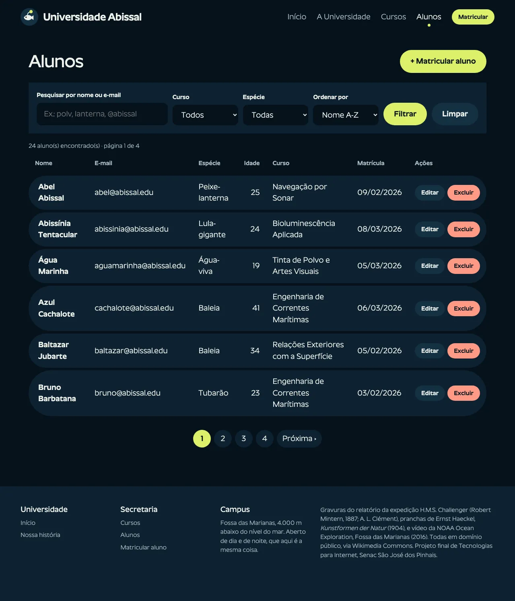
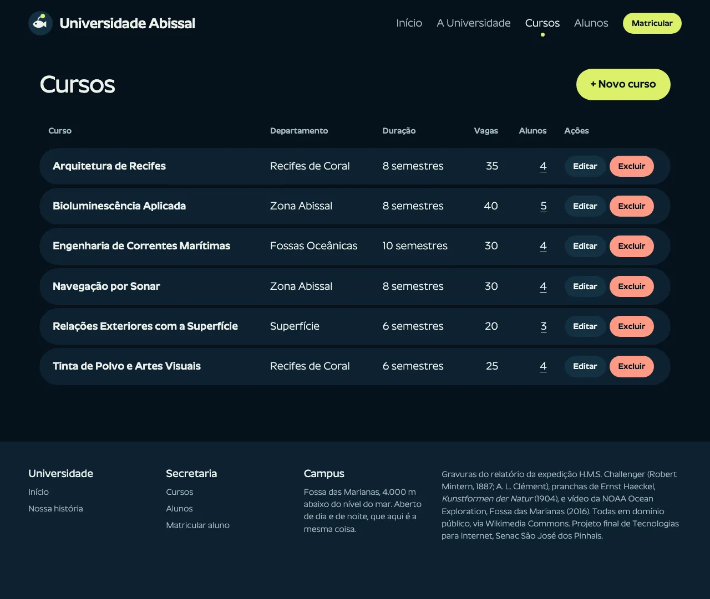
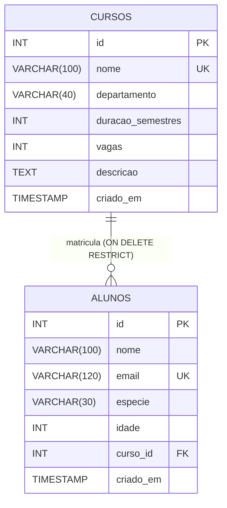
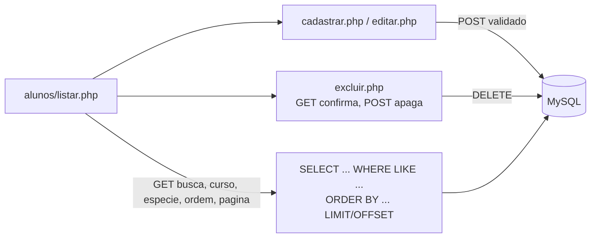

# Universidade Abissal

> Onde o conhecimento brilha mesmo a 4.000 metros de profundidade.

Projeto final **My Crazy University** da disciplina Tecnologias para Internet (Senac São José dos Pinhais, ADS).


## Integrantes

- Pedro Szpak
- _(adicione aqui os demais integrantes do grupo)_

## Tema

Uma universidade no fundo do oceano: o campus fica numa fossa a 4.000 metros, os alunos são polvos, lulas, baleias e peixes-lanterna, e os cursos vão de Bioluminescência Aplicada a Relações Exteriores com a Superfície.

## Descrição do sistema

Website institucional com dois cadastros ligados ao MySQL:

- **Cursos:** cadastrar, consultar, editar e excluir. Um curso com alunos não pode ser excluído.
- **Alunos:** cadastrar, consultar, editar e excluir, com **pesquisa por nome ou e-mail (`LIKE`)**, **filtros por curso e espécie**, **ordenação** (A-Z, Z-A, mais recentes, mais antigos) e **paginação com `LIMIT`/`OFFSET`** que mantém a pesquisa, os filtros e a ordem.

| Alunos: pesquisa, filtros, ordenação e paginação | Cursos: contagem de alunos por curso |
|---|---|
|  |  |

Prints do sistema rodando com `php -S` e o `database/banco.sql` (dados de exemplo, todos fictícios).

## Como funciona





Detalhes de banco, fluxo e segurança estão em [`docs/DOCUMENTACAO.md`](docs/DOCUMENTACAO.md).

## Tecnologias

- PHP 8 (sem framework)
- MySQL / MariaDB
- PDO com prepared statements
- HTML5, CSS3 e um pouco de JavaScript (`assets/js/movimento.js`), fonte Roundo do Fontshare

## Como executar

### 1. Criar o banco

Com o MySQL do XAMPP ligado, importe o arquivo `database/banco.sql`:

- **phpMyAdmin:** aba *Importar* → escolha `database/banco.sql` → *Executar*; ou
- **terminal:** `mysql -u root -p < database/banco.sql`

O script cria o banco `universidade_abissal`, as tabelas `cursos` e `alunos` e 6 cursos com 24 alunos de exemplo.

### 2. Configurar a conexão

A conexão fica em `config/conexao.php`. Os valores padrão já servem para o XAMPP:

| Variável | Padrão |
|---|---|
| `DB_HOST` | `127.0.0.1` |
| `DB_PORT` | `3306` |
| `DB_NAME` | `universidade_abissal` |
| `DB_USER` | `root` |
| `DB_PASS` | _(vazio)_ |

Se o seu MySQL usa outra senha ou porta, altere os valores padrão no arquivo ou defina as variáveis de ambiente.

### 3. Rodar

**XAMPP:** copie a pasta do projeto para `htdocs/` e acesse `http://localhost/universidade-abissal/`.

**Servidor embutido do PHP:**

```bash
php -S localhost:8000
# abra http://localhost:8000
```

## Estrutura

```text
index.php, institucional.php   páginas institucionais
config/conexao.php             conexão PDO
includes/                      cabeçalho, rodapé e funções compartilhadas
cursos/                        CRUD de cursos
alunos/                        CRUD de alunos (com pesquisa, filtros, ordem e paginação)
assets/                        CSS, JS, logotipo e gravuras/vídeo em domínio público (créditos em `assets/fotos/credits.json`)
database/banco.sql             script do banco
docs/DOCUMENTACAO.md           documentação sistêmica
docs/media/                    prints do README
```
