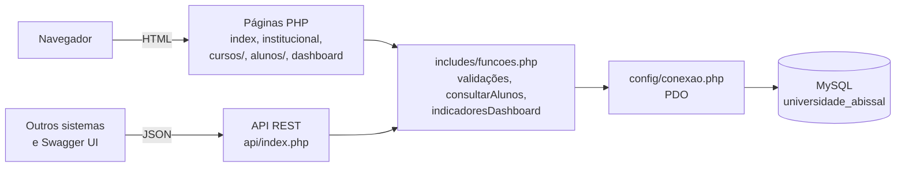

# 3. Arquitetura

O sistema é PHP sem framework, organizado por responsabilidade. As telas e a API compartilham a mesma camada de regras.



## Estrutura dos arquivos

```text
universidade-abissal/
├── index.php                 página inicial
├── institucional.php         página institucional
├── dashboard.php             painel de indicadores
├── api/
│   ├── index.php             API REST (JSON)
│   ├── openapi.yaml          especificação OpenAPI 3
│   ├── docs.html             Swagger UI
│   └── .htaccess             URL curta no Apache (/api/cursos)
├── config/
│   └── conexao.php           conexão PDO (lê DB_HOST, DB_PORT, DB_NAME, DB_USER, DB_PASS)
├── includes/
│   ├── funcoes.php           sessão, h(), mensagens flash, validações, consultas compartilhadas
│   ├── cabecalho.php         <head>, menu e mensagem flash
│   └── rodape.php            rodapé e fechamento do HTML
├── cursos/                   CRUD de cursos (listar, cadastrar, editar, excluir, _form)
├── alunos/                   CRUD de alunos (listar com pesquisa/filtros/paginação, cadastrar, editar, excluir, _form)
├── assets/                   CSS, JS, logotipo e imagens em domínio público
├── database/
│   └── banco.sql             criação do banco, tabelas e dados de exemplo
└── docs/                     esta documentação
```

## Fluxo de um cadastro

```text
Usuário preenche o formulário
        │  POST
        ▼
PHP recebe ($_POST) e aplica trim()
        │
        ▼
Validação (validarAluno / validarCurso)
        │
   ┌────┴─────┐
 inválido    válido
   │            │
   ▼            ▼
Mostra erros   prepare() → bindValue() → execute()
e mantém os        │
valores no         ▼
formulário     MySQL grava (INSERT/UPDATE/DELETE)
                   │
                   ▼
            Mensagem flash na sessão + redirecionamento
                   │
                   ▼
            Listagem exibe a mensagem uma vez
```

Na consulta, o caminho é: parâmetros da URL (`busca`, `curso`, `especie`, `ordem`, `pagina`) → validação de cada um → montagem do `WHERE` só com trechos fixos → `COUNT(*)` para saber o total de páginas → `SELECT ... LIMIT :limite OFFSET :offset` → tabela e links de paginação que repetem os mesmos parâmetros.

---

← [Requisitos](02-requisitos.md) · [Índice](README.md) · [Banco de dados](04-banco-de-dados.md) →
