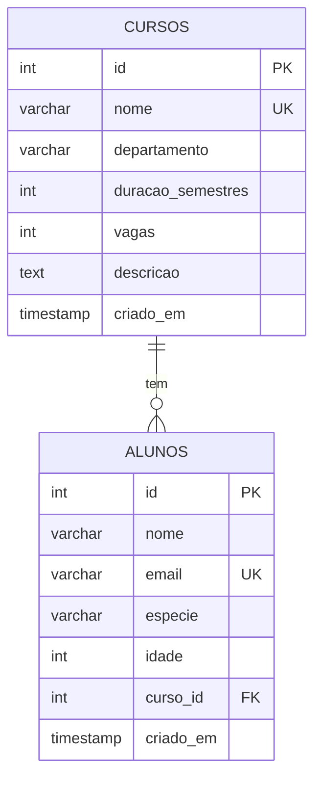

# 4. Banco de dados

Banco `universidade_abissal`, charset `utf8mb4`.

### Tabela `cursos`

| Campo | Tipo | Regra |
|---|---|---|
| `id` | INT, AUTO_INCREMENT, PK | gerado pelo banco |
| `nome` | VARCHAR(100), UNIQUE | obrigatório, sem repetição |
| `departamento` | VARCHAR(40) | um dos 4 departamentos |
| `duracao_semestres` | INT | inteiro de 1 a 12 |
| `vagas` | INT | inteiro maior que zero |
| `descricao` | TEXT | opcional |
| `criado_em` | TIMESTAMP | preenchido pelo banco |

### Tabela `alunos`

| Campo | Tipo | Regra |
|---|---|---|
| `id` | INT, AUTO_INCREMENT, PK | gerado pelo banco |
| `nome` | VARCHAR(100) | obrigatório |
| `email` | VARCHAR(120), UNIQUE | formato válido, sem repetição |
| `especie` | VARCHAR(30) | uma das espécies da lista |
| `idade` | INT | inteiro de 1 a 500 (polvos vivem pouco, baleias muito) |
| `curso_id` | INT, FK → `cursos.id` | precisa existir |
| `criado_em` | TIMESTAMP | data da matrícula, usada na ordenação |

Relacionamento: **um curso tem vários alunos** (1:N). A chave estrangeira usa `ON DELETE RESTRICT`, então um curso com alunos não pode ser apagado; a tela de exclusão avisa isso antes.

O script completo, com dados de exemplo (6 cursos e 24 alunos), está em [`database/banco.sql`](../database/banco.sql).

---

← [Arquitetura](03-arquitetura.md) · [Índice](README.md) · [Funcionalidades](05-funcionalidades.md) →
